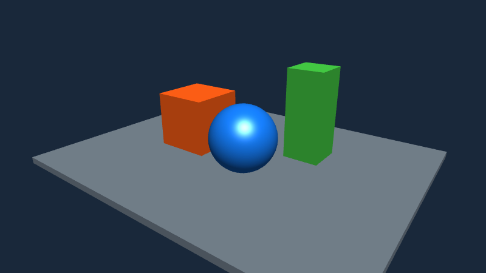
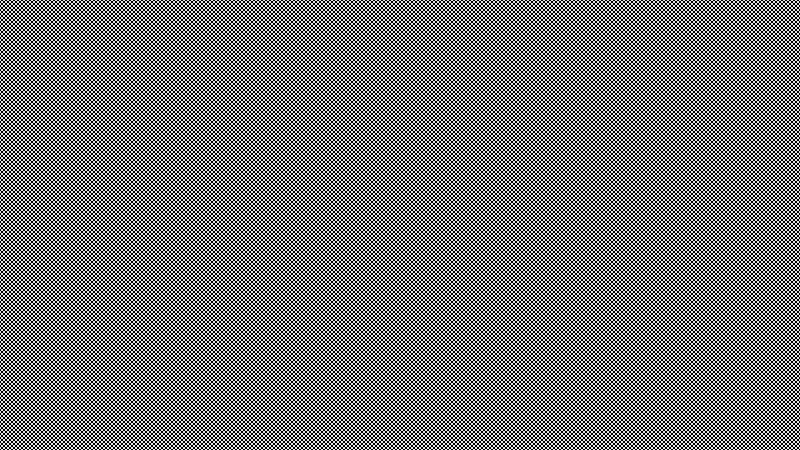
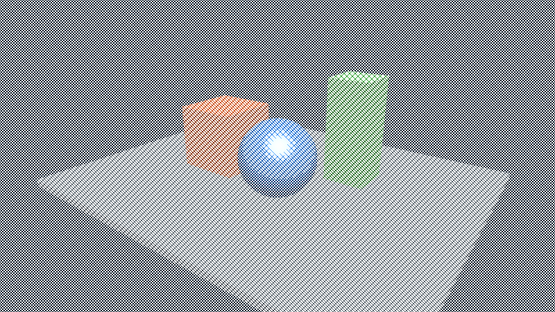

# Post-filter MSAA reproduction

Actual 800 x 450 framebuffer readbacks from a primitive-only jMonkeyEngine scene; no external assets. Both runs enable four samples on FilterPostProcessor. The scene, camera and light setup are identical.

Before: upstream master `421607125e1be72d38e0e514cfb7cbda2d696f20`.
After: only the ContrastAdjustment/CrossHatch shader corrections proposed on `codex/pr-msaa-filter-sampling`.

On the tested NVIDIA RTX 3050 desktop OpenGL driver, ContrastAdjustment produces a black frame before the fix. CrossHatch produces only its black/white pattern, losing the scene. Incorrect sampler/texture combinations have undefined output; other drivers can look different. The regression test checks the actual compiled sampler type as well as pixel output.

| Filter | Before | After |
| --- | --- | --- |
| ContrastAdjustment |  |  |
| CrossHatch |  |  |

`MsaaFilterProbe.java` is the complete finite reproduction, compiled against engine core, desktop, effects and LWJGL3 runtime classpaths. Run as `MsaaFilterProbe gl /tmp/contrast.png contrast` or `MsaaFilterProbe gl /tmp/hatch.png hatch`. It requests OpenGL 3.3 through an X11-preferred offscreen surface, captures frame eight and exits. `gles` selects ANGLE for the existing resolve fallback; its before/after frames were byte-identical.

These images and the probe are kept on a separate evidence branch so binary assets are absent from the fix PR.
