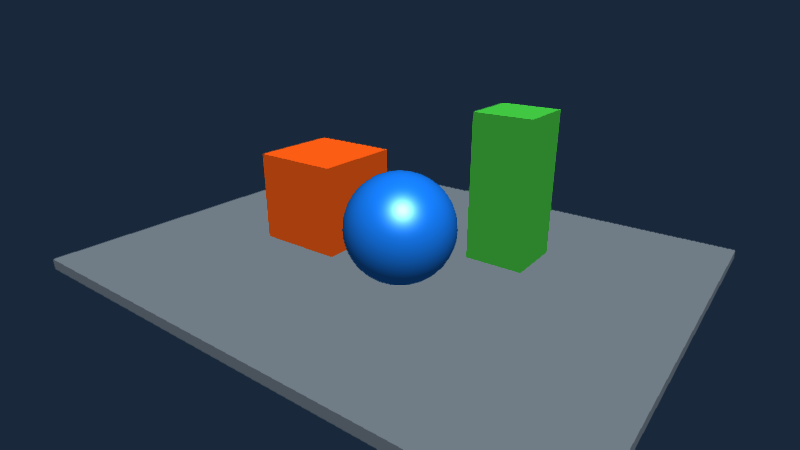

# Post-filter initialization: black screen before, scene after

The app adds FXAA, adds bloom, then disables bloom before attaching the processor:

```java
FilterPostProcessor filters = new FilterPostProcessor(assetManager);
filters.addFilter(new FXAAFilter());
BloomFilter bloom = new BloomFilter();
filters.addFilter(bloom);
bloom.setEnabled(false);
viewPort.addProcessor(filters);
```

This should display the scene with FXAA and without bloom. Before the fix, the
processor remembers the disabled bloom filter as the end of the chain. FXAA
renders offscreen and the final scene output stays black. Refreshing the last
enabled filter during initialization restores the final output.

| Before | After |
| --- | --- |
|  |  |

These are 800 x 450 OpenGL framebuffer captures of the supplied engine-only
`PostFilterSceneEvidence.java`. Geometry, lighting, camera and settings are identical.
The source uses jME primitives and built-in materials, an offscreen surface, no
input app states, zero MSAA samples, and captures after warm-up frames.

The control uses upstream `924534323f8c221e9a5d45b08180fced8ebb99bc`'s
`FilterPostProcessor`; the fixed build is `345e1b63f063b58470e6636f612df03867fbc495`.
The same control and fixed cases also ran on ANGLE/GLES, with the same black versus
visible-scene result. All four processes exited successfully. No framebuffer
pixels were edited.
